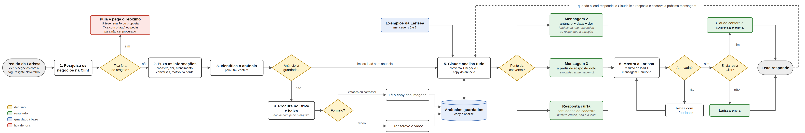

# Resgate de leads · Metta

## Baixar o plugin

**[Baixar resgate-leads-plugin.zip](https://github.com/Metta-Brasil/metta-resgate-leads/releases/latest/download/resgate-leads-plugin.zip)**

Link direto: `https://github.com/Metta-Brasil/metta-resgate-leads/releases/latest/download/resgate-leads-plugin.zip`

Para instalar no app do Claude: abra a tela de **Plugins**, clique em **Enviar um plugin** e escolha esse arquivo. O zip é atualizado sozinho a cada mudança no plugin; o link continua o mesmo.

Não use o botão verde **Code > Download ZIP** do GitHub: ele baixa o repositório inteiro, e o Claude recusa com o erro "plugin.json must be at .claude-plugin/plugin.json".

## Para que serve este repositório

Este repositório tem uma função só: trabalhar a **Campanha Resgate** na Clint, os leads que se cadastraram, nunca tiveram reunião e esfriaram.

Para cada lead, o plugin:

- lê o lead na Clint: cadastro, anúncio, dor, histórico e conversas em todos os números;
- aplica as travas: quem já fez reunião, está em negociação em outro funil, pediu para parar ou já foi abordado não recebe mensagem;
- prepara a próxima mensagem, pronta para a SDR aprovar:
  - **mensagem 1**, a ativação;
  - **mensagem 2**, com o anúncio pelo qual ele se cadastrou e a dor dele;
  - **mensagem 3**, escrita a partir do que ele respondeu, para levar ao agendamento do diagnóstico.

**O envio é manual**, pela Clint, depois da aprovação da SDR. O envio automático pela API da Clint existe, mas só roda com autorização explícita de quem está usando.

## Como funciona



O resgate tem cinco etapas. A primeira acontece uma vez para cada anúncio. As outras se repetem a cada lote de leads.

**0. Biblioteca de anúncios (uma vez por anúncio).** Todo lead chegou por um anúncio. Antes de falar com qualquer lead, o Claude acha esse anúncio no Drive e lê o que ele diz. No vídeo, ele transcreve a fala. Depois confere se o anúncio ainda pode ser usado hoje: sem promessa vencida, sem número antigo, sem cliente que não pode aparecer. Também prepara uma versão leve do arquivo, que o WhatsApp aceita. Uma pessoa confere e aprova, e só anúncio aprovado vai para lead. Como o mesmo anúncio serve a muitos leads, ele é conferido uma vez só.

**1. Lote e travas.** Você diz quais leads quer trabalhar, por exemplo todos com o motivo "Interesse futuro". O Claude lê cada um na Clint:
- quando se cadastrou;
- por qual anúncio;
- que problema contou;
- tudo o que já foi conversado, em todos os números.

Depois ele separa quem não pode receber mensagem:
- quem já teve reunião;
- quem está negociando em outro funil;
- quem pediu para não ser procurado;
- quem já recebeu o resgate;
- quem está conversando agora com alguém da Metta.

Você confere a lista e aprova.

**2. Mensagem 1.** Uma pergunta curta: "Olá, neste número ainda falo com [nome]?". Ela só confirma que o número ainda é da pessoa. Quem não responde fica para o follow-up da SDR.

**3. Mensagem 2.** Quando a pessoa responde, o Claude lê a resposta antes de qualquer coisa.
- Se for o próprio lead, ele prepara a mensagem 2: o anúncio pelo qual o lead se cadastrou, a data do cadastro e o problema que ele contou.
- Se for número errado, outra pessoa ou pedido para parar, não vai nada disso, só uma resposta curta e educada. Os dados do lead nunca chegam a outra pessoa.

**4. Mensagem 3.** Quando o lead responde à mensagem 2, o Claude lê o que foi enviado de verdade e o que ele respondeu. Então escreve a resposta para aquele caso:
- se o problema continua, oferece dois horários com o especialista;
- se ele perguntou preço, explica que a conversa com o especialista vem antes;
- se ele já resolveu ou pediu para parar, encerra com educação.

**Em toda mensagem:**
- antes de mostrar, o Claude confere o texto: campo vazio, preço, emoji, palavra que não pode;
- você aprova, pede ajuste ou edita;
- logo antes do envio, o Claude relê a conversa. Se o lead mandou algo novo nesse meio tempo, a mensagem é refeita;
- quem envia é a SDR, pela Clint. O Claude só envia se você autorizar com todas as letras.

O desenho editável do fluxograma está em `docs/fluxograma.mmd` (abre em mermaid.live).

## Como o repositório é organizado

```
metta-resgate-leads/
├── README.md                          → este guia
├── docs/fluxograma.png                → o fluxograma do resgate
├── .gitignore                         → impede que dado de lead, anúncio baixado ou token subam
├── .github/workflows/plugin-zip.yml   → gera o zip do plugin a cada mudança
├── .claude-plugin/
│   └── marketplace.json               → a "loja" metta-resgate
└── plugins/
    └── resgate-leads/                 → o plugin que se instala
        ├── .claude-plugin/plugin.json
        ├── .mcp.json                  → conector da Clint
        └── skills/
            ├── resgate-leads/         → lote, travas, dossiê e mensagens 1, 2 e 3
            │   ├── references/leitura-clint.md
            │   ├── references/mensagens.md
            │   └── scripts/conferir.py
            ├── resgate-biblioteca/    → biblioteca de anúncios (lê, confere e prepara cada anúncio)
            │   ├── references/ficha-do-anuncio.md
            │   ├── scripts/biblioteca.py
            │   └── scripts/midia.py
            └── resgate-envio/         → envio pela API da Clint, só com autorização
                └── scripts/enviar_clint.py
```

## Instalar (uma vez)

O computador precisa ter:
- o Claude Code (no terminal ou na aba Code do app Claude, em sessão local);
- git e Python 3;
- ffmpeg (`brew install ffmpeg`);
- o **Google Drive para computador**, com o drive compartilhado dos criativos aparecendo como pasta;
- para transcrever os anúncios em vídeo: `pip3 install faster-whisper`.

No Claude Code, digite:

```
/plugin marketplace add Metta-Brasil/metta-resgate-leads
/plugin install resgate-leads@metta-resgate
```

Feche e abra o Claude Code. Depois, digite `/mcp`, escolha **clint** e faça o login na Clint.

Se o primeiro comando der erro de SSH, use o endereço completo:

```
/plugin marketplace add https://github.com/Metta-Brasil/metta-resgate-leads.git
```

**Primeira vez:** peça ao Claude "Configura o resgate". Ele cria a pasta `~/Metta-Resgate/` com o `config.json`. Informe:
- a pasta local do drive de criativos;
- o nome de quem envia as mensagens;
- a lista de clientes que não podem aparecer em material, que fica só no seu computador.

## Receber as atualizações

Digite `/plugin`, abra a aba **Marketplaces**, escolha **metta-resgate** e selecione **Enable auto-update**. Para atualizar na hora: `/plugin marketplace update metta-resgate`.

A biblioteca de anúncios, os arquivos de cada lead e o `config.json` ficam em `~/Metta-Resgate/`, fora do plugin. A atualização não apaga nada disso.

## Usar

Abra o Claude Code e peça:

| Para | Digite |
|---|---|
| Montar a biblioteca antes do primeiro lote | `Monta a biblioteca de anúncios do resgate` |
| Montar um lote e a mensagem 1 | `Monta o lote do resgate: motivo "Interesse futuro"` |
| Ver quem respondeu e preparar a próxima mensagem | `Ver respostas do resgate` |
| Um lead específico | `O <nome do lead> respondeu no resgate` |

O resultado fica em `~/Metta-Resgate/saida/`:
- um arquivo por lead, com o dossiê e as mensagens;
- `_lote_<data>.md`, com o status de cada lead.

Cada mensagem vem num bloco de código único, com a formatação do WhatsApp. Copie só o que está dentro do bloco. O que está fora é instrução para a SDR.

**Biblioteca de anúncios:** cada anúncio é lido uma vez e só vai para o lead depois que alguém valida a ficha. Quando o resgate encontra um anúncio novo, ele monta a ficha e pede a validação.

## Antes de enviar

- **Status REVISAR ou BLOQUEADO:** leia o motivo.
- **Mensagem 2:** mande o anúncio primeiro e o texto logo depois.
- **Mensagem 3 com horários:** preencha com horários reais da agenda do especialista. Com colchete, ela não passa na conferência.
- **Número oficial:** a mensagem 1 sai como modelo aprovado (escolha na caixa da Clint). As mensagens 2 e 3 só saem com texto livre até 24 horas depois da última mensagem do lead.
- **Na dúvida, peça a checagem final:** `Confere antes de eu enviar para o <lead>`. O Claude relê a conversa e diz se algo mudou.

## Envio automático (opcional)

Só roda se você autorizar de forma explícita: `Autorizo enviar pela Clint as mensagens aprovadas de <lead ou lote>`.

O que precisa:
- uma chave de API da Clint com permissão de mensagens, salva em `~/Metta-Resgate/.clint_token` (nunca neste repositório);
- número WhatsApp Oficial;
- para o anúncio, um endereço público e direto do arquivo.

Antes de cada envio, o Claude confere se a conversa mudou, se a janela está aberta e se é horário comercial, e mostra a prévia para o seu "ok".

## Importante

Este repositório é público. Nunca suba dado de lead, conversa, anúncio baixado, biblioteca, token ou lista de clientes.
